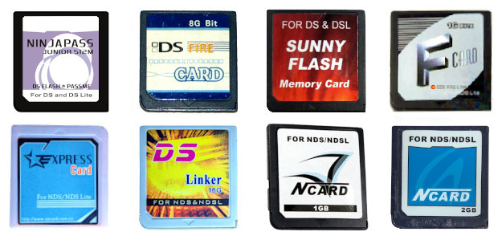

# nrioTool
_A tool for dumping hidden SRL rom sections from N-Card and it's clones._

(F-Card, Fire Card, DS-Linker and NeoFlash MK5 are known clones of N-Card). Some recovery options are also available for DLDI section of the cart.

## List of Known Carts

Tested:
- DS Fire Link (8GBit, 16GBit).
- DS-Linker (16GBit).
- ExpressCard (16GBit).

## Usage
* CIA build provided for 3DS users, this has been tested and I can confirm that it works (thx to SylverReZ).
* In theory, it is possible to use this tool on a DS/DS Lite using a slot2 flashcard device of some kind, as I have tried to add code for this. But since the only slot2 device I have is a MAX Media Dock, and its DLDI driver doesn't appear to work in modern homebrew, I cannot test this.
* "nrioFiles" folder goes to SD card of your DSi/3DS console. The included FAT image is targeted for 16GBit cards and contains the default setup for N-Card XMenu 2.55/uDisk 1.45, including an updator for updating a cart to uDisk 1.45 for those who have bricked cards and can't boot it normally to run this updator. Note that while these are N-Card firmware files, they will work on almost all of the clones, as they are based off the same hardware-wise. ;)
  You can easily use a program like [WinImage](https://www.winimage.com/) to replace the files in the FAT image if you wish to use your own firmware files for this.
* "title" folder is for HiyaCFW users. Copy this into the root path of your SD card to install the title directly to your System Menu. NDS file can be used in Unlaunch for those who do not wish to do this. (regardless an Unlaunch exploited console is required to use this tool!)

## Features
* Two menus are available. The main menu and the recovery menu.
* Main Menu can do the following things: 
	1. Dump stage2 SRL.
	2. Dump hidden uDisk SRL.
	3. Do a 10000 or so sector dump of hidden section of nand. On my 16GBit DS Linker, there appears to be nothing but FF data after that so that's all it's set to dump for now.
	4. Do a small dump of hidden section of nand in alternate mode that contains the primary rom.
	5. Switch into Recovery Menu. Note that once you do this, you can't exit this menu without restarting the console!
* Recovery Menu can do the following things:
	1. Dump FAT sector 0.
	2. Restore sector 0. You can format this card via slot DS/DS Lite and the slot2 device connected to PC but note the card expects specific data in sector 0.
	   This tool can restore a copy of it if you have dumped a copy of it before formatting.
	3. Write default FAT image to card. An image for 16g capacity cards is included. Note that other capacities are not currently supported until FAT image jumps of them become available.
	4. Ability to boot into bootstrap program to launch files on cart. Allows booting uDisk updator as a result so can recover a bricked cart!

## DSi SD recovery

On a DSi with SD mounted, open the Utility Menu with **L**. It now offers these recovery actions:

- **Y — Install DSi safe mode.** Prepare the patch from the cart's own stock safe-mode ROM. An optional `sd:/nrioFiles/safe-mode.nds` must match the target ROM outside the header and ARM7 sectors and carry a recognized relocation patch. Erased `FF` padding after the declared ROM length is accepted up to the next power-of-two size (at least 128 KiB). The patch still requires the live header and ARM7 sector to be in block 0.
- **R — Install banner.** Read `sd:/nrioFiles/banner.bin` and update the first v1 banner copy at NAND offset `0x2000`. The input can be `0x800` bytes or a full `0x840`-byte banner with a zero-filled final `0x40` bytes. The second banner copy and recognized ARM7 boot records in the spare area are preserved. ECC is regenerated only for existing ECC-format banner records.
- **SELECT — Back up block 0.** Save `main.bin` and packed `spare.bin` in the next `sd:/nrioFiles/block0-NNN` directory.
- **UP — Restore banner ARM7.** Repair page 4's spare record if the two intact ARM7 copies from pages 1 and 5 agree and the live page-4 damage matches the old banner writer's ECC pattern. The current banner and all other records are preserved. The tool saves a block-0 backup before confirmation.

The install and restore paths first save the target's block-0 backup to SD. The confirmation screen recommends keeping a backup from before the fault whenever possible. The reminder adds no backup requirement. Hold **L + R** and press **A** to write. The tool verifies the live block against the backup before erase and reads back the entire block afterward. Apache confirmed SD backup export and banner display on hardware with the initial build. This was a different cart from the verified DS Linker. It white-screened afterward and had no pre-write boot test. Apache suspected an existing uDisk problem. The revised banner writer preserves the ARM7 spare record in emulation and still needs hardware testing. The ExpressCard's raw before-and-after dumps matched the old writer's output byte for byte. It changed 472 banner bytes and 34 ARM7 spare bytes, all on NAND page 4. The restore passed emulation on the actual post-write main and spare dumps and preserved the replacement banner. Apache confirmed on hardware that the ExpressCard booted again after the targeted ARM7 restore.

The existing devkitARM Makefiles build this branch with libnds 1.8.3 and libfat-nds 1.1.5. Set `LIBNDS` to the directory containing both legacy packages. [Integration notes](https://github.com/nextcode4u/DLDI-REA-Decomp/tree/b66838d/n-card/nrioTool)

## DS and DS Lite recovery with Slot-2 storage

Launch `nrioTool.nds` from a Slot-2 storage device with its writable DLDI driver patched into the ROM. Put `nrioFiles` at the root of that device. The Utility Menu uses `fat:/nrioFiles` for backups and optional input files on this setup. In DSi mode it continues to use `sd:/nrioFiles`.

Hold **L** at launch to jump straight to recovery before the regular Slot-1 initialization. **SELECT** saves a block-0 backup from the N-Card in Slot-1. Recovery is available in DS mode when nrioTool mounts a read/write Slot-2 DLDI device. This avoids storing its backups on the Slot-1 cart being repaired. The Slot-2 path has been checked in software and still needs a physical DS or DS Lite test.

## Recover block 0 from a backup

While the cart is working, press **SELECT** in the Utility Menu to save a restore-ready backup. Keep `main.bin`, `spare.bin`, and `backup.info` together in their numbered folder. Backups from earlier builds lack the metadata used by this menu.

If the cart stops booting, launch nrioTool from the DSi SD card or Slot-2 storage while holding **L** to enter recovery before the regular cart initialization. The NAND bridge must still answer the raw probe. Press **Down**, use **Left/Right** to choose the backup from that same cart, then press **A**. The app checks the file CRCs, NAND geometry, and saved data at `0x40000` and `0x80000`. Those data checks help catch a mismatched backup. Always use the original cart's backup.

After the app saves the current block to a separate backup folder, hold **L + R** and press **A** to restore. It checks the live snapshot before erase and verifies every main and spare byte after writing. This restores block 0 only. If block 0 is erased and there is no prior backup, the narrower ARM7 repair can help only when its required copies survive. The new startup shortcut and full restore still need a physical DSi test.

## Credits
lifehackerhansol: Improvements to file read logic.

SylverReZ: Troubleshooting bugs.
